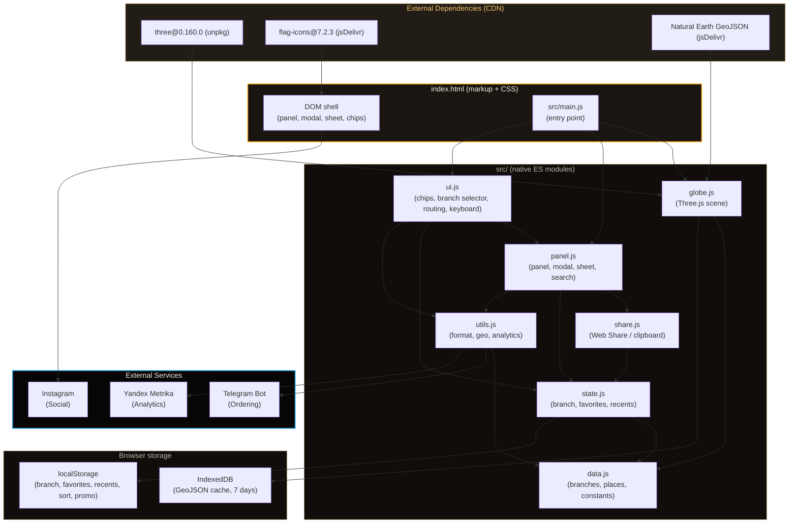

# 🌍 Burger Embassy — Flavor Passport

> An interactive 3D globe where every dish is a visa to a new country.
> Spin the globe, tap a marker, order in Telegram.

**Live:** [GitHub Pages](https://deviancevxxxxm.github.io/embassy_globe/) · **Telegram bot:** [@burgerembassy_uzbot](https://t.me/burgerembassy_uzbot) · **Instagram:** [@burgerembassyuz](https://www.instagram.com/burgerembassyuz/)

---

## 📖 Table of Contents

- [Overview](#overview)
- [Design Goals](#design-goals)
- [Feature Set](#feature-set)
- [Architecture](#architecture)
- [Project Structure](#project-structure)
- [Local Development](#local-development)
- [Data Model](#data-model)
- [3D Scene Deep-Dive](#3d-scene-deep-dive)
- [UX Decisions](#ux-decisions)
- [Accessibility](#accessibility)
- [Performance](#performance)
- [Analytics & Tracking](#analytics--tracking)
- [Internationalization](#internationalization)
- [Design Tokens](#design-tokens)
- [Deployment](#deployment)
- [Browser Support](#browser-support)
- [Roadmap](#roadmap)
- [License](#license)

---

## Overview

**Burger Embassy** is a single-page marketing and ordering experience for a Tashkent-based burger chain. Instead of a flat menu, the entire catalog is organized geographically — each burger is tied to a country of origin (New York, Istanbul, Seoul…) and lives as a glowing marker on a rotating 3D Earth.

**The core interaction:**
1. User sees the globe spinning slowly.
2. Drags to rotate, zooms with wheel/pinch.
3. Taps a marker → side panel slides in with the country's menu.
4. Taps a dish → modal with photo, price, calories, allergens.
5. Clicks "Order in Telegram" → hands off to the bot with UTM + branch context.

The app is a static page: `index.html` (markup + CSS, ~48 KB) plus a handful of native **ES modules** in `src/` (~93 KB unminified). Three.js is imported straight from a CDN inside `src/globe.js`. No build step, no bundler, no framework.

---

## Design Goals

| Goal | How we achieve it |
|---|---|
| **Wow-factor on first paint** | Rotating 3D Earth with atmospheric glow, particle stars, pulsing markers |
| **Zero-build deployment** | Static `index.html` + native ES modules (`src/`) + CDN imports |
| **Works on slow networks** | Graceful WebGL fallback → opens list view; geoJSON with 8s timeout |
| **Mobile-first** | Touch gestures, bottom-sheet panel, FAB list, geolocation |
| **Keyboard & screen-reader friendly** | Focus trap, ARIA roles, `prefers-reduced-motion` |
| **Order-driven** | Sticky Telegram CTA everywhere; UTM + branch in `start` payload |
| **Low-ops** | No backend, no database — static file + Telegram bot |

**Anti-goals:** we're not building an app shell, a PWA install-first flow, or a CMS. Content is edited by editing the `places` and `branches` arrays in `src/data.js`.

---

## Feature Set

### 🗺️ Interactive Globe
- Spinning 3D Earth (Three.js) with procedurally-painted country map
- Drag-rotate + wheel/pinch zoom
- 16 markers (one per place in `places`), each with pulsing ring animation
- Country highlight overlay (additive-blended sphere with per-country canvas texture)
- Auto-rotate after 1.4s idle, pauses on hover or when any panel is open
- World GeoJSON is cached in IndexedDB (7-day TTL) → repeat visits paint the map without a network request

### 🏳️ Country Chips
- Horizontal chip bar built from `countries` (aggregated by ISO), each with flag, name and dish count
- Tap a chip → opens that country's combined menu and highlights it on the globe
- Scroll arrows appear when the bar overflows

### 📋 Menu Browser
- Panel with search, category chips, sort (price ↑↓, discount, new), "in stock only" toggle
- Item cards: photo, badges (−%, new), price, old price, weight
- Highlight matched text in search results (`<mark>`)
- Empty state with clickable search suggestions + reset button

### 🛒 Dish Detail Modal
- Hero image (`object-fit: contain` on white bg — never cropped)
- Kicker with country · city · allergens · calories
- Favorite (♥) and Share (Web Share API with clipboard fallback, see `src/share.js`)
- Shared link is a deep link to the dish's place **and** the current branch: `<origin><path>#/<placeId>?branch=<branchId>`
- Disabled state for out-of-stock items

### 📍 Branch Selector
- 15 branches with real open/closed status computed in **Asia/Tashkent** timezone
- Geolocation: "Detect nearest" → Haversine distance → auto-select if < 100 km
- "Only open now" filter
- Persists in `localStorage` (`manual` / `auto` / `url` / `default` source); default branch is `mirzo`
- Order links carry the branch: `https://t.me/burgerembassy_uzbot?start=branch_<id>&utm_source=site&utm_medium=button&utm_campaign=order`

### 🔍 Global Search (Sheet)
- "All places" bottom sheet with global dish search
- Recent places + favorites as quick chips
- Shortcut `/` on desktop

### 🎨 Design Details
- Promo banner (dismissable for 24h)
- Toast notifications for actions
- Loading spinner with 8s timeout
- Onboarding hint fades after 6.5s
- Skeuomorphic gold-on-dark palette

---

## Architecture



The page is loaded with a single `<script type="module" src="./src/main.js">`; every other module is pulled in through `import` statements. There is no bundler — the browser resolves the graph itself.

---

## Project Structure

```text
/
├── index.html          markup, CSS, CSP meta, Metrika ID, <script type="module">
├── favicon.ico
├── og-cover.jpg        1200×630 social preview (Open Graph / Twitter card)
├── assets/             dish photos (300×300 jpeg)
└── src/
    ├── main.js         entry point: init analytics, PWA manifest, globe, UI, hash restore
    ├── data.js         constants, storage keys, ISO2 map, CATEGORIES, branches[], places[], countryIndex
    ├── state.js        branchState, favorites, recents (localStorage-backed, cross-tab sync)
    ├── utils.js        DOM/format helpers, analytics (initMetrika/track), Tashkent time, geo math, order URL
    ├── globe.js        Three.js scene, markers, map painting, GeoJSON IndexedDB cache, camera control
    ├── panel.js        side panel / bottom sheet, dish modal, global search sheet, filters & sorting
    ├── ui.js           country chips, branch selector, promo banner, hash routing, keyboard handling
    └── share.js        shareItem(): Web Share API with clipboard fallback
```

### Module responsibilities

| Module | Responsibility | Key exports |
|---|---|---|
| **`data.js`** | Static data and constants. Imports nothing, so anything can import it. The only place to edit when adding dishes or branches. | `IMG_BASE`, `ORDER_URL`, `METRIKA_ID`, `*_KEY`, `ISO2`, `CATEGORIES`, `branches`, `places`, `countryIndex`, `countries` |
| **`state.js`** | Current branch (+ source, distance, "open only"), favorites (max 30), recents (max 8). Loads from `localStorage` on import and invalidates caches on the `storage` event. | `branchState`, `setBranch()`, `setOpenOnly()`, `getFavorites()`, `toggleFavorite()`, `isFavorite()`, `itemKey()`, `getRecent()`, `pushRecent()` |
| **`utils.js`** | Formatting (`fmt`, `escapeHtml`, `highlightSafe`), toasts, `track()`, `isBranchOpen()` in **Asia/Tashkent**, Haversine `distanceKm()`, `findNearestBranch()`, `requestGeolocation()`, `getOrderUrl()`, `prefetchImages()`, `detectCategory()` | see file |
| **`globe.js`** | `initGlobe({ onMarkerClick })` → `{ hasWebGL, moveCameraTo, highlightCountry }`. Detects WebGL, builds scene, paints the map from cached/fetched GeoJSON, handles pointer/touch/raycasting and the render loop. | `initGlobe()` |
| **`panel.js`** | Panel (`openPlace`, `openCountry`, `closePanel`, `applyFilter`), dish modal (`openModal`, `closeModal`), global search sheet (`buildSheet`, `renderGlobalSearch`, `openSheet`, `closeSheet`), `buildHash()` | see file |
| **`ui.js`** | Country chips with scroll arrows, branch dropdown (`selectBranch`, geolocation, open-only filter), promo banner, `restoreFromHash()` / `hashchange`, global keyboard handling (Escape hierarchy, `/`, focus trap) | `initUI()`, `restoreFromHash()`, `selectBranch()` |
| **`share.js`** | Builds the share payload (title, text, deep link) and tries `navigator.share`, falling back to `navigator.clipboard.writeText` + toast | `shareItem()` |
| **`main.js`** | Wires everything together: `initMetrika()` → inline PWA manifest → `initGlobe()` → `setGlobeController()` (or opens the sheet when WebGL is missing) → `initUI()` → `restoreFromHash()` → hides the onboarding hint after 6.5 s | — |

### Routing

Hash format: `#/<placeId>?branch=<branchId>` or `#/<ISO>?branch=<branchId>`

- `#/tashkent?branch=ukchi` — opens the Tashkent place with branch `ukchi` selected (`source: 'url'`)
- `#/USA` — opens the combined USA menu (country view)
- Unknown route → toast + hash cleared; empty hash → everything closes

### localStorage keys

| Key | Holds |
|---|---|
| `be_branch_v1` | selected branch id |
| `be_branch_source_v1` | `manual` / `auto` / `url` / `default` |
| `be_branch_open_filter_v1` | `'1'` when "only open now" is on |
| `be_favorites_v1` | favorite dishes (JSON, max 30) |
| `be_recent_v1` | recently opened places (JSON, max 8) |
| `be_sort_v1` | selected sort order |
| `be_promo_dismissed_v1` | promo banner dismissal (24 h) |

IndexedDB: database `be_geo_v1`, store `geojson` — cached world GeoJSON, entries older than 7 days are purged.

---

## Local Development

There is no build step, but the code uses native ES modules, which browsers **do not load from `file://`**. Serve the folder over HTTP:

```bash
git clone https://github.com/DEViANCEVxXXxM/embassy_globe.git
cd embassy_globe
python3 -m http.server 8000      # or: npx serve .
# open http://localhost:8000
```

Useful URL flags:

- `?debug` — logs every `track()` call to the console- `#/<placeId>?branch=<branchId>` — jump straight to a place with a given branch

`localhost` counts as a secure context, so geolocation and `navigator.share` can be tested locally.

---

## Data Model

### Branch

```js
{
  id: 'mirzo',                       // used in ?start=branch_mirzo
  name: 'Мирзо Улугбека, 55',
  address: '',
  hours: 'Круглосуточно',            // or '10:00 – 23:00'
  is24: true,
  lat: 41.3250,
  lon: 69.3250,
}
```

### Place

```js
{
  id: 'newyork',
  name: 'New York',
  country: 'США',
  iso: 'USA',                        // must match GeoJSON ADM0_A3
  lat: 40.7128,
  lon: -74.0060,
  items: [ /* Dish[] */ ],
}
```

### Dish

```js
{
  n: 'New York Burger',              // name
  p: 52000,                          // price (UZS)
  old: 63000,                        // optional: old price → auto −% badge
  w: '325 г',                        // weight
  e: '🍔',                           // emoji fallback
  i: 'abc123-300x300.jpeg',          // filename in /assets
  d: 'Говяжья котлета, чеддер…',     // description
  out: true,                         // optional: out of stock
}
```

### Category

`Category (derived, not stored)`

Categories are auto-detected from the name by `detectCategory()`:

```js
/салат/                 → salads
/фондан|чизкейк|донат/  → desserts
/сет/                   → sets
/хотдог/                → hotdogs
/cola|sprite|чай|сок/   → drinks
/burger|бургер/         → burgers
```

Each category carries static metadata (`kcal`, `allergens`) — so we don't need to maintain the same info per dish.

## 3D Scene Deep-Dive

### Sphere stack

```text
scene
├── earth          (96×64 sphere, MeshPhongMaterial + canvas map texture)
├── hlSphere       (96×64, additive-blended overlay for country highlight)
├── grid           (lat/lon lines, 15° step)
├── atmosphere     (backside-rendered shader glow)
├── stars          (1100 points, spherical distribution r=14..40)
└── 16 marker groups
    ├── ring       (RingGeometry 0.026–0.034, pulsing)
    ├── dot        (Sphere 0.013, scales on hover)
    └── hit        (invisible Sphere 0.075 desktop / 0.11 touch)
```

### Map painting

On load, we fetch `ne_110m_admin_0_countries.geojson` and paint each country's polygon onto a 2048×1024 canvas using the equirectangular projection:

```js
function lonLatToXY(lon, lat) {
  return [ ((lon + 180) / 360) * 2048, ((90 - lat) / 180) * 1024 ];
}
```

The canvas is then uploaded as `THREE.CanvasTexture`.

Why canvas instead of a pre-rendered texture? Zero dependencies — no image asset to host, no risk of stale borders. The GeoJSON is fetched from jsDelivr and stored in **IndexedDB** (`GeoCache` in `src/globe.js`, 7-day TTL); on the next visit it is read from the cache first, and a corrupted entry is dropped and re-fetched. If IndexedDB is unavailable the map is simply fetched every time.

### Country highlight

When a country is selected, we render its polygon onto a second canvas (`hlCanvas`) with warm gold fill and glowing stroke, then apply it to `hlSphere`. Because it uses `AdditiveBlending`, it glows over the base map without obscuring it.

### Rotation model

```js
// Yaw/pitch instead of quaternion input → easier to clamp
globe.quaternion = qX(pitch) * qY(yaw);
```

- Yaw: free 360° spin
- Pitch: clamped to ±65°
- Auto-rotate kicks in after 1.4s of no interaction — pauses on marker hover or when any panel/modal/sheet is open
- `prefers-reduced-motion` disables auto-rotate and pulsing rings

### Raycasting

Each marker carries a low-poly invisible sphere (`hit mesh`) with a larger radius on touch devices:

```js
const IS_TOUCH = window.matchMedia('(pointer:coarse)').matches;
const HIT_GEO = new THREE.SphereGeometry(IS_TOUCH ? 0.11 : 0.075, 12, 12);
```

This is the single biggest win for mobile UX — the visible dot is tiny (0.013), but the hit target is finger-sized.

## UX Decisions

### Bottom-sheet on mobile, side-panel on desktop

The menu lives in `<aside class="panel">`. On mobile it's a bottom sheet (85 vh, swipe-to-close on the drag handle); on desktop it slides in from the right and pushes the globe left via `targetYaw` offset.

```js
const yawOffset = isMobile ? 0 : -0.22;       // shift globe left when panel opens
const pitchOffset = isMobile ? -0.55 : 0;     // tilt down to keep markers visible
```

### Auto-zoom to marker

When a country opens, we don't snap — we tween over ~1 second using `yaw += dyaw * ease`. This orients the globe so the selected country faces the user.

### Multi-layer Escape hierarchy

Escape closes in this priority:

1. Branch dropdown (if open)
2. Modal
3. Sheet
4. Panel

This prevents “double-close” bugs where Escape kills two layers at once.

### Focus management before `aria-hidden`

Setting `aria-hidden="true"` on a container whose descendant has focus triggers a Chrome/Safari warning. We always call `blurIfContains(el)` before hiding, and in `closeModal()` we try to restore focus to the trigger first.

### Disabled link, not disabled button

Out-of-stock dishes use `<a aria-disabled="true" class="disabled">` with `pointer-events: none`. This keeps the DOM stable and avoids disabled styling resets from UA stylesheets.

### Deferred analytics

Metrika only loads if `window.__METRIKA_ID__` is set in `index.html`. Debug mode (`?debug`) logs every `track()` call to console — great for QA without polluting the production dashboard.

## Accessibility

| Requirement | Implementation |
| --- | --- |
| Keyboard nav | Branch dropdown: ↑↓ Home End Enter Esc; chips: Tab; modal: focus trap |
| Focus visible | `:focus-visible` gold outline on all interactive elements |
| Screen reader | `role="dialog"`, `aria-modal`, `aria-labelledby`, `aria-describedby`, `aria-live="polite"` on count, `aria-pressed` on favorite |
| Touch targets | ≥ 44×44 on all buttons; hit spheres ×2 on coarse pointers |
| Reduced motion | `@media (prefers-reduced-motion)` disables animations + auto-rotate + marker pulse |
| Color contrast | All text ≥ 4.5:1 against backgrounds (gold-on-dark ≥ 7:1) |
| No-JS / no-WebGL fallback | Auto-opens sheet with full list; panel/modal/search still work |
| Deep-link errors | Invalid `#/xxx` shows toast instead of blank screen |
| Form states | Search, checkbox, sort all have visible focus + hover |

## Performance

| Concern | Mitigation |
| --- | --- |
| 3D scene cost | 96×64 sphere segments (not 128×128); markers are <10 tris each |
| Map texture | 2048×1024 canvas painted once on load, reused via `CanvasTexture` |
| GeoJSON fetch | Cached in IndexedDB for 7 days → repeat visits skip the network request |
| Image loading | `loading="lazy"` on thumbnails; `opacity: 0 → 1` fade on load; `onerror` → hide |
| Image prefetch | `prefetchImages(place)` fires on marker hover, preloads top 3 dishes |
| GeoJSON timeout | 8-second watchdog; if slow, we let the app run without the map |
| WebGL detection | Tested before creating renderer; failure → sheet opens automatically |
| Raycast throttling | Only runs on `pointermove` when not dragging; skipped entirely on touch |
| CSS containment | Panels use transform (GPU-composited) instead of left/top |

No build step means no minification — `index.html` is ~48 KB and the `src/` modules add ~93 KB unminified, and all heavy assets (Three.js, GeoJSON, flag-icons) are CDN-cached.

## Analytics & Tracking

Yandex Metrika is integrated but off by default:

```html
<!-- index.html -->
<script>window.__METRIKA_ID__ = null;</script>
```

Set it to your counter ID **in `index.html`** to enable. `src/data.js` reads `window.__METRIKA_ID__` once, at import time — before the body of `src/main.js` runs — so the inline script in `index.html` is the only place where the value takes effect.

Events tracked:

| Event | Params |
| --- | --- |
| `open_country` | `{ country }` |
| `open_place` | `{ place, country }` |
| `open_item` | `{ item, price, place, country }` |
| `click_order` | `{ item, branch, price }` |
| `favorite` | `{ item, added }` |
| `favorite_remove_from_sheet` | `{ key }` |
| `share` | `{ item, place }` |
| `sort` | `{ value }` |
| `open_sheet` | — |
| `select_branch` | `{ branch, source }` |
| `geolocate_click` | — |
| `geolocate_ok` | `{ branch, distance }` |
| `geolocate_err` | `{ message }` |
| `geolocate_far` | `{ distance }` |
| `branch_filter_open` | `{ enabled }` |

Debug mode: open any page with `?debug` in the URL — all events log to `console.log`.

## Internationalization

Currently Russian only. Strings live in `index.html`, in the data in `src/data.js` and, for toasts and dynamic labels, in the modules under `src/`. For future multi-language:

- Content strings (`name`, `d`, `country`) live in the data model — could become `{ ru, uz, en }` objects
- UI strings (~40) are scattered — should be extracted to a `STRINGS` map if i18n becomes a requirement
- Date/time formatting already uses `Intl.DateTimeFormat` with explicit `Asia/Tashkent` timezone — the foundation is right

## Design Tokens

```css
/* Palette */
--bg-deep:      #070605;
--bg-mid:       #100d0a;
--surface-1:    rgba(32,28,24,.82);
--border-gold:  rgba(200,160,80,.18);
--gold:         #f5a623;
--gold-light:   #f5c76a;
--text-primary: #f5efe6;
--green:        #3ecf7f;
--red:          #ff7d7d;
--tg-blue:      #2AABEE;

/* Radii */
--radius-pill:  999px;
--radius-card:  14px;
--radius-panel: 20px;
--radius-sheet: 24px;

/* Motion */
--ease-out:     cubic-bezier(.22,.9,.24,1);
--dur-short:    .2s;
--dur-medium:   .3s;
--dur-long:     .5s;
```

Touch targets, spacing, and typography scale with the `@media (max-width: 900px)` breakpoint — no mobile detection in JS.

## Deployment

Fully static. Drop the folder onto any CDN:

```text
/ (root)
├── index.html
├── favicon.ico
├── og-cover.jpg          (1200×630, for Telegram/WhatsApp previews)
├── src/                  (ES modules — must be deployed together with index.html)
│   ├── main.js
│   ├── data.js
│   ├── state.js
│   ├── utils.js
│   ├── globe.js
│   ├── panel.js
│   ├── ui.js
│   └── share.js
└── assets/
    ├── adfecde1cb66d522582c97b9f75b060f-300x300.jpeg
    └── … (82 dish photos)
```

Requirements:

- HTTPS (for `navigator.geolocation` and `navigator.share`)
- Path stays `/` — manifest `start_url` uses `location.origin + pathname`
- `.js` files must be served with a JavaScript MIME type (all common static hosts do this by default) — otherwise browsers refuse to load ES modules
- No special headers required
- Recommended hosts: Cloudflare Pages, Vercel, Netlify, GitHub Pages, any nginx

### Content Security Policy

`index.html` ships a CSP `<meta>` tag. Allowed external origins: `cdn.jsdelivr.net` (flag-icons, GeoJSON), `unpkg.com` (Three.js), `mc.yandex.ru` / `yandex.ru` / `yandex.com` (Metrika). Inline scripts and styles are allowed via `'unsafe-inline'`. If you add another CDN or third-party script, add its origin to `script-src` / `connect-src` (and `style-src` / `img-src` where relevant). `frame-ancestors` does not work via `<meta>` — set `X-Frame-Options: DENY` on the server if clickjacking protection is needed.

### Post-deploy checklist

- [ ] Set `window.__METRIKA_ID__` to your Yandex counter ID in `index.html`
- [ ] Replace `og-cover.jpg` with branded social card
- [ ] Verify `favicon.ico` at `/favicon.ico` (browser + PWA)
- [ ] Test geolocation prompts on mobile
- [ ] Test Telegram bot receives `/start branch_mirzo utm_source=site…`
- [ ] Verify `navigator.share()` on iOS Safari and Android Chrome

## Browser Support

| Browser | Version | Notes |
| --- | --- | --- |
| Chrome / Edge | 90+ | Full experience |
| Safari (macOS) | 15+ | Web Share API requires user gesture (handled) |
| Safari (iOS) | 15+ | Add to Home Screen works (manifest inline) |
| Firefox | 90+ | `navigator.share` unsupported → falls back to clipboard |
| Firefox | < 121 | No `:has()` — handled with JS flag classes |
| WebView (Telegram) | Current | Telegram WebView supports WebGL — verified |
| No WebGL | Any | Auto-opens list view; no globe but full menu |

## Roadmap

### ✅ Shipped

- 3D globe with country highlight
- Panel + modal + sheet + global search
- Branch selector with geolocation + real-time status
- Favorites, recents, share, categories, sorting
- Analytics hooks, PWA manifest, a11y, i18n-ready tokens
- Code split from a single `index.html` into native ES modules (`src/`) — data, state, globe, panel, UI and share are separate files
- Country chips with scroll arrows, branch-aware share links (`#/<placeId>?branch=<id>`)
- IndexedDB cache for the world GeoJSON (7-day TTL)
- Open Graph / Twitter card preview (`og-cover.jpg`)

### 🚧 Next

- [ ] Uzbek / English translations (extract strings)
- [ ] Composition / allergen page — expand `CATEGORIES` metadata into per-dish info
- [ ] Order in bot without leaving site — Telegram Web App integration
- [ ] Menu CMS — move `places[]` (now in `src/data.js`) to a JSON endpoint so ops can edit without deploy
- [ ] Photo gallery — 2–3 images per dish (currently 1)
- [ ] Service Worker — offline-first menu, stale-while-revalidate
- [ ] Delivery ETA — show ~30 мин next to price

### 💭 Ideas parked

- AR mode (point phone at table, see the menu)
- Globe “fly to” animation on deep-link
- Story-like “today’s pick” feed

## License

Internal project for Burger Embassy Tashkent.
Built with ❤️ and no framework.
